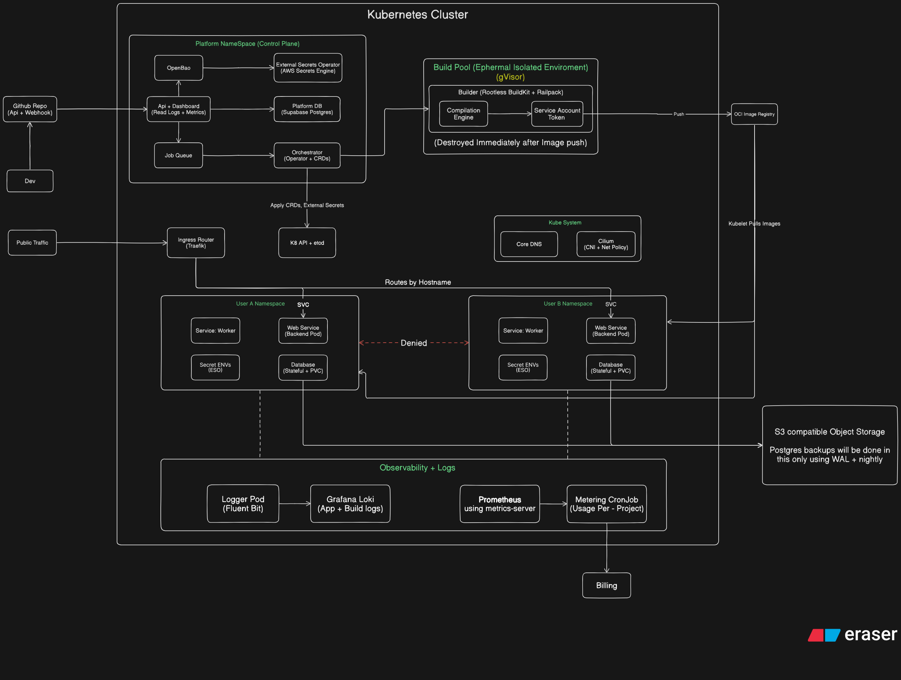

# Summit Documentation Index & Architecture Map

Welcome to the central documentation index for the **Summit** (Jetway) edge-native Developer Platform-as-a-Service (PaaS) control plane.

---

## 1. System Architecture Overview

Summit bridges developer Git workflows with Kubernetes execution across isolated tenant environments.



### Key Architectural Tenets
- **Decoupled Identity & Tenancy:** Supabase Auth issues JWT tokens; GitHub App integration is decoupled from platform login. Multi-tenancy is enforced strictly at the database query and namespace levels.
- **Transactional Outbox Dispatch:** Asynchronous build, deploy, and infrastructure provisioning operations are committed transactionally to `outbox_events` and consumed via PostgreSQL row-locking (`FOR UPDATE SKIP LOCKED`).
- **Untrusted Code Containment:** All customer code compilation runs exclusively inside ephemeral **gVisor (`runsc`)** sandbox pods using **rootless BuildKit** and **Railpack**. Priyanshu owns the builder and host gVisor setup; Rudra owns pod scheduling and lifecycle.
- **MVP OCI Registry:** GHCR (`ghcr.io`) is the proposed external registry, avoiding an in-cluster registry service on the test hosts. Application image ownership follows the source repository: organization login for organization-owned projects, GitHub username for personal projects. See [`ghcr_mvp_setup.md`](./ghcr_mvp_setup.md); visibility and push authentication still need confirmation.
- **Zero Secrets in Platform DB:** Secret values are never stored in plaintext or ciphertext in the platform database; External Secrets Operator (ESO) and OpenBao synchronize credentials directly into Kubernetes tenant namespaces.

---

## 2. Core Implementation Plans

The control plane is divided into three primary engineering domains with explicit ownership boundaries:

| Engineer / Role | Subsystem & Scope | Target Implementation Doc | Current Status |
|---|---|---|---|
| **Priyanshu**<br>*(API & Builder Engineer)* | Go HTTP control plane, REST endpoints, middleware, GitHub integration, and the complete isolated builder (host gVisor setup, rootless BuildKit, Railpack, and builder image) | [`docs/implementation_priyanshu.md`](./implementation_priyanshu.md) | **ACTIVE**<br>API foundation and GitHub integration merged; builder remains |
| **Arpit**<br>*(Platform Database Engineer)* | Supabase Postgres platform persistence, relational schemas, migrations, advisory locks, connection pooling (`pgxpool`), and transactional outbox | [`docs/implementation_arpit.md`](./implementation_arpit.md) | **ACTIVE**<br>Migrations 0001 & 0002 implemented with advisory locks and CI harness |
| **Rudra**<br>*(Orchestrator & Cluster Controller)* | Outbox reconciler, Kubernetes scheduling and build pod lifecycle, CRDs, Cilium network policies, Traefik ingress, and ESO; uses Priyanshu's configured builder/runtime | [`docs/implementation_rudra.md`](./implementation_rudra.md) | **ACTIVE**<br>Ready for outbox reconciler loop and build pod coordinator |

---

## 3. GitHub Integration Backend Suite

The complete backend specification, frontend integration contracts, and verification reports for the GitHub integration:

- **[`docs/integrations/github/GITHUB_INTEGRATION_BACKEND_SPEC.md`](./integrations/github/GITHUB_INTEGRATION_BACKEND_SPEC.md):** Canonical 7-phase technical specification covering the data model, security boundaries, GitHub App client, raw HMAC webhook processing, build worker credential broker, and error taxonomy.
- **[`docs/integrations/github/FRONTEND_INTEGRATION.md`](./integrations/github/FRONTEND_INTEGRATION.md):** Frontend and MCP integration guide containing sequence diagrams, HTTP contract definitions, curl payloads, error codes, and tool schemas.
- **[`docs/integrations/github/IMPLEMENTATION_REPORT.md`](./integrations/github/IMPLEMENTATION_REPORT.md):** Complete implementation verification report documenting the 15 backend packages, 9 atomic conventional commits, multi-agent review resolutions, and 100% passing test coverage.

---

## 4. API Specification & Contract

- **`packages/api_spec/openapi.yaml`:** Authoritative OpenAPI 3.1 specification for the platform REST API.
- **`packages/api_spec/`:** TypeScript types compiled from the specification for consume by `apps/web`.

## 5. MVP OCI Registry

- [`ghcr_mvp_setup.md`](./ghcr_mvp_setup.md): GHCR application image naming, owner resolution, pull authentication, cluster setup, and the open trusted-push credential decision.

---

## 6. Repository Subsystem & Package Map

```text
Summit Monorepo (Turborepo 2.11+)
├── apps/
│   ├── backend/                              # Go 1.26 API Control Plane, Orchestrator & Worker Engine
│   │   ├── cmd/
│   │   │   ├── api/                          # Server executable & background worker spawner
│   │   │   └── migrate/                      # Advisory-locked database migration CLI
│   │   └── internal/
│   │       ├── audit/                        # Redacted audit event logger
│   │       ├── auth/                         # Supabase JWT verifier (JWKS / HS256) & user sync
│   │       ├── authz/                        # Multi-tenant RBAC middleware & permission matrix
│   │       ├── config/                       # Environment configuration parser
│   │       ├── db/                           # pgxpool lifecycle & schema migration runner
│   │       │   └── migrations/               # 0001_baseline.up.sql & 0002_github_integration.up.sql
│   │       ├── githubapi/                    # HTTP handlers: installations, repos, sources, deploys
│   │       ├── githubapp/                    # GitHub App REST client, RS256 JWT, token cache
│   │       ├── githubwebhook/                # Raw HMAC-SHA256 verifier & event normalizer
│   │       ├── githubworker/                 # Async SKIP LOCKED poller & worker credential broker
│   │       ├── health/                       # Health check endpoints
│   │       ├── httpx/                        # RFC 7807 JSON error envelopes & response helpers
│   │       ├── installstate/                 # Single-use CSRF/state generator & SHA-256 verifier
│   │       ├── secrets/                      # OpenBao AppRole client & multi-tier secrets router
│   │       ├── server/                       # HTTP multiplexer & graceful shutdown handler
│   │       ├── sourcepath/                   # Path traversal & root directory sanitizer
│   │       └── testutil/                     # Isolated schema test database runner
│   └── web/                                  # Next.js 16 Console Dashboard (Prototype Mocks)
├── docs/                                     # Architecture & Implementation Plans
│   ├── integrations/github/                  # GitHub Integration spec, frontend guide & report
│   ├── implementation_arpit.md               # Arpit: Database & Outbox Plan
│   ├── implementation_priyanshu.md           # Priyanshu: Go API Control Plane Plan
│   ├── implementation_rudra.md               # Rudra: Orchestrator & Kubernetes Engine Plan
│   ├── ghcr_mvp_setup.md                     # Proposed external OCI registry setup for MVP
│   └── system_architechture.png              # System Architecture Diagram
├── packages/
│   └── api_spec/                             # OpenAPI 3.1 Contract & Generated TypeScript types
├── turbo.json                                # Turborepo pipeline configuration
└── package.json                              # Workspace root scripts & dependency definitions
```

---

## 7. Current Implementation Status Matrix

| Subsystem | Area | Current State | Target Owner | References |
|---|---|---|---|---|
| **Monorepo** | Turborepo Pipeline | **Complete** (build, test, lint, dev, typecheck) | Team | [`turbo.json`](../turbo.json) |
| **API** | Health Probes | **Complete** (`/api/v1/health`, `/health`) | Priyanshu | [`internal/health`](../apps/backend/internal/health) |
| **API / Auth** | Supabase JWT & RBAC | **Complete** (JWKS caching, algorithm allowlists, RBAC) | Priyanshu | [`internal/auth`](../apps/backend/internal/auth) |
| **API / GitHub** | Installations & Repos | **Complete** (OAuth callback, repo sync, sources, deploys) | Priyanshu | [`internal/githubapi`](../apps/backend/internal/githubapi) |
| **Webhooks** | Ingestion & Queue | **Complete** (Raw HMAC, deduplication, `SKIP LOCKED` worker) | Priyanshu | [`internal/githubworker`](../apps/backend/internal/githubworker) |
| **Security** | Secrets Management | **Complete** (OpenBao AppRole, dev fallback controls) | Priyanshu / Arpit | [`internal/secrets`](../apps/backend/internal/secrets) |
| **Database** | Migrations & Pool | **Complete** (`0001` & `0002` applied, pgxpool, advisory locks) | Arpit | [`internal/db`](../apps/backend/internal/db) |
| **Orchestrator** | Worker Broker | **Complete** (Job-scoped JWT authentication on broker endpoint) | Priyanshu / Rudra | [`internal/githubworker`](../apps/backend/internal/githubworker) |
| **Orchestrator** | Outbox Reconciler | **Ready to Implement** (Reads `outbox_events` table) | Rudra | [`docs/implementation_rudra.md`](./implementation_rudra.md) |
| **Builder / Orchestrator** | gVisor Builder & Pod Lifecycle | **Planned** (Priyanshu owns gVisor + builder; Rudra owns pod scheduling and lifecycle) | Priyanshu / Rudra | [`docs/implementation_priyanshu.md`](./implementation_priyanshu.md), [`docs/implementation_rudra.md`](./implementation_rudra.md) |
| **Registry** | OCI image storage | **Proposed MVP direction: GHCR** (source-repository owner resolution decided; visibility and push-auth contract pending) | Rudra / Priyanshu | [`ghcr_mvp_setup.md`](./ghcr_mvp_setup.md) |
| **Frontend** | Console Dashboard | **Prototype / In-Memory Mock** | UI Developer | [`apps/web`](../apps/web) |
