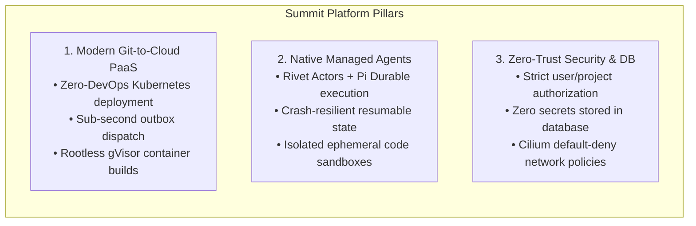

# Summit Presentation Deck & Architecture Guide

Welcome to the comprehensive presentation and slide preparation suite for **Summit (Jetway)**: the next-generation Developer Platform-as-a-Service (PaaS) with native, durable **Managed Autonomous Agents**.

This documentation package provides all the modular content, diagrams, architectural specifications, business strategy, and slide-by-slide copy needed to build a winning pitch deck, technical architecture review, or hackathon demo presentation.

---

## 1. Document Suite Overview

The presentation material is structured into modular markdown files for easy consumption and direct conversion into PowerPoint, Keynote, Marp, or Pitch:

| Document | Title | Focus & Contents |
| :--- | :--- | :--- |
| **[`01_PROBLEM_AND_BUSINESS_VISION.md`](./01_PROBLEM_AND_BUSINESS_VISION.md)** | **Market Problem & Business Strategy** | Industry pain points, developer friction, market size, business model, monetization tiers, unit economics, and competitive analysis against AWS, Vercel, and Railway. |
| **[`02_HIGH_LEVEL_SYSTEM_ARCHITECTURE.md`](./02_HIGH_LEVEL_SYSTEM_ARCHITECTURE.md)** | **End-to-End System Architecture** | Full platform architectural blueprints, Mermaid diagrams, Control Plane vs. Data Plane separation, request lifecycles, and network topologies. |
| **[`03_MANAGED_AGENTS_SUBSYSTEM_DEEP_DIVE.md`](./03_MANAGED_AGENTS_SUBSYSTEM_DEEP_DIVE.md)** | **Managed Agents with Rivet & Pi Durable** | Actor model runtime, Pi Durable integration, Gate 1 PoC validation, crash-recovery guarantees, idempotency boundaries, and credential brokering. |
| **[`04_CORE_PLATFORM_COMPONENTS_BREAKDOWN.md`](./04_CORE_PLATFORM_COMPONENTS_BREAKDOWN.md)** | **Core Platform Components Breakdown** | In-depth breakdown of the 6 foundational engines: Go API Control Plane, Platform DB & Outbox, K8s Orchestrator, Isolated gVisor Builder, GitHub Integration Suite, and Web Console. |
| **[`05_SECURITY_ISOLATION_AND_RELIABILITY.md`](./05_SECURITY_ISOLATION_AND_RELIABILITY.md)** | **Security, Isolation & Reliability** | Zero-trust threat model, gVisor `runsc` kernel sandboxing, OpenBao + External Secrets Operator, Cilium CNI network policies, and transactional outbox recovery. |
| **[`06_SLIDE_BY_SLIDE_PRESENTATION_CONTENT.md`](./06_SLIDE_BY_SLIDE_PRESENTATION_CONTENT.md)** | **Slide-by-Slide Deck Master** | 15 ready-to-use slides with slide titles, visual layout blueprints, speaker notes, key takeaways, and presenter cues. |

---

## 2. High-Level Pitch Narrative

### The One-Liner
> **Summit is the first edge-native Developer PaaS engineered from the ground up to combine instant Git-to-Kubernetes deployments with durable, sandboxed Autonomous AI Agents.**

### The 3 Core Pillars of Summit

1. **Autonomous Agents as First-Class Workloads:** Modern PaaS platforms treat AI as an external API call. Summit treats agents as stateful, durable, long-running actors capable of coding, debugging, and maintaining workloads inside hardened sandboxes.
2. **True Kernel-Level Sandboxing:** Untrusted builds and agent code runs inside ephemeral Google gVisor (`runsc`) virtualized kernels with rootless BuildKit and Railpack.
3. **Rock-Solid Distributed Architecture:** Transactional Outbox pattern on PostgreSQL guarantees sub-second event dispatch with zero lost events, paired with a Go control plane and Kubernetes reconciler.

---

## 3. Recommended Presentation Formats

Depending on your presentation time and audience, use the following slide selections:

### A. The 5-Minute Investor / Hackathon Pitch (7 Slides)
- **Slide 1:** Title & Value Proposition (`06_SLIDE_BY_SLIDE_PRESENTATION_CONTENT.md#slide-1`)
- **Slide 2:** The Problem: Modern PaaS is Blind to Autonomous Agents (`Slide 2`)
- **Slide 3:** The Solution: Summit PaaS + Managed Agent Subsystem (`Slide 3`)
- **Slide 4:** High-Level Architecture & Secret Sauce (`Slide 4`)
- **Slide 8:** Managed Agents with Rivet & Pi Durable (`Slide 8`)
- **Slide 12:** Business Model, Unit Economics & Market Opportunity (`Slide 12`)
- **Slide 15:** Roadmap, Team & Call to Action (`Slide 15`)

### B. The 15-Minute Technical Architecture Deep-Dive (12 Slides)
- **Slide 1:** Title & Architecture Scope (`Slide 1`)
- **Slide 4:** Complete System Architecture & Topologies (`Slide 4`)
- **Slide 5:** Go Control Plane & Transactional Outbox (`Slide 5`)
- **Slide 6:** Isolated Ephemeral Builder with gVisor (`Slide 6`)
- **Slide 7:** Kubernetes Orchestrator Daemon & CRD Loops (`Slide 7`)
- **Slide 8:** Rivet Actor Model & Pi Durable Runtime (`Slide 8`)
- **Slide 9:** Agent Actor Keying & Session Isolation (`Slide 9`)
- **Slide 10:** Zero-Trust Security, OpenBao & Network Segmentation (`Slide 10`)
- **Slide 11:** Developer Experience: Git & Agent Workflow (`Slide 11`)
- **Slide 14:** Verified Gate 1 PoC & Production Readiness (`Slide 14`)
- **Slide 15:** Q&A & Technical Discussion (`Slide 15`)

### C. The Comprehensive 20-Slide Master Deck
Follow the full sequence in **[`06_SLIDE_BY_SLIDE_PRESENTATION_CONTENT.md`](./06_SLIDE_BY_SLIDE_PRESENTATION_CONTENT.md)** for exhaustive coverage of technical, operational, security, and business dimensions.
