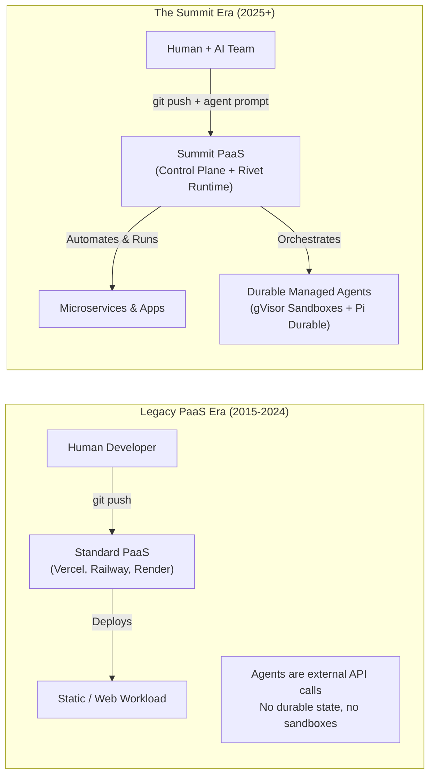
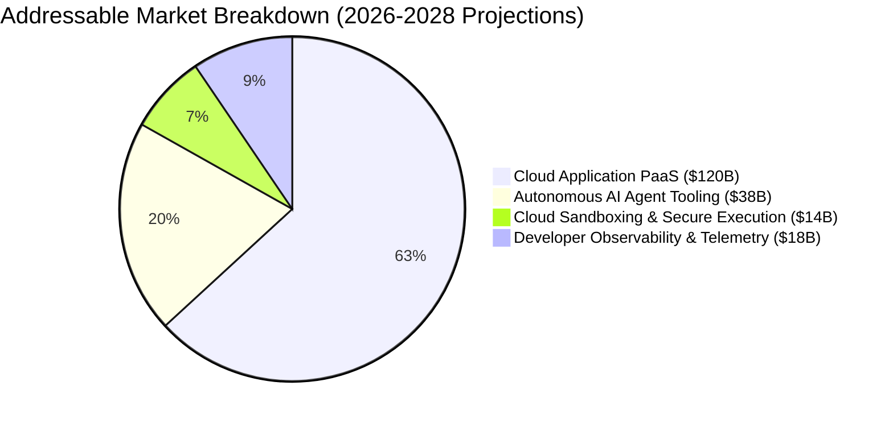
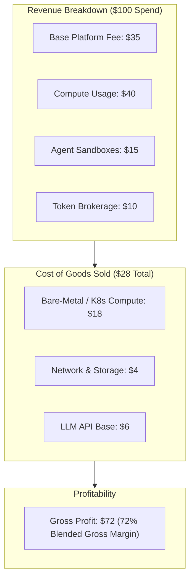

# Summit: Problem Statement, Market Opportunity & Business Strategy

---

## 1. Executive Summary & Market Problem

### The Paradigm Shift: From Human-Only Code to Autonomous Agent Collaboration
Over the last decade, platforms like Vercel, Railway, and Render revolutionized developer experience by abstracting raw cloud infrastructure (AWS/GCP) into instant Git-to-deploy workflows. However, the software engineering landscape is undergoing its largest structural transition in 30 years: **the emergence of autonomous AI software engineers and background agents**.

Today's developers do not just write code; they deploy autonomous agents to write tests, fix bugs, refactor legacy systems, monitor deployments, and perform migrations. Yet, our cloud infrastructure has not evolved to support them.



### The 4 Fatal Flaws of Existing Cloud Platforms

1. **Blindness to Stateful Agent Lifecycles:**
   Current serverless and container PaaS platforms are designed for short HTTP requests (15s–15min timeouts). Autonomous coding agents run for hours, require complex multi-step reasoning, sleep during external waits, and need instant resumption after infrastructure failure without losing hours of context.
2. **The Untrusted Code Dilemma (Weak Sandboxing):**
   Coding agents generate and execute arbitrary bash commands, install dependencies, and modify files. Running this on shared Docker hosts risks kernel-escape attacks, while spinning up full cloud VMs takes 30–90 seconds and costs dollars per hour.
3. **Severe Credential Leaks & Secret Exfiltration:**
   Standard PaaS injects environment variables directly into container environments. If an agent has shell access, it can trivially read all database credentials, third-party API tokens, and production keys via `env` or malicious prompts.
4. **DevOps Overhead vs. Cloud Complexity:**
   Setting up dedicated Kubernetes clusters, gVisor sandboxes, outbox queues, OpenBao secret management, and actor engines currently requires 3+ full-time senior DevOps engineers and months of custom glue code.

---

## 2. The Summit Value Proposition

Summit bridges the gap by delivering a **Unified Edge-Native PaaS with Native Managed Autonomous Agents**:

| Capability | Legacy PaaS (Vercel / Railway) | DIY Cloud (AWS EKS / GCP GKE) | **Summit PaaS** |
| :--- | :--- | :--- | :--- |
| **Deployment Flow** | Git push $\rightarrow$ Container | Manual CI/CD, Helm, YAMLs | **Git push $\rightarrow$ Auto-detected Railpack Build** |
| **Agent Support** | None (External APIs only) | Custom orchestration required | **Native Rivet Actors + Pi Durable Runtime** |
| **Execution Sandboxing** | Standard shared Docker | Heavy EC2 VMs / Firecracker | **Ephemeral gVisor (`runsc`) Micro-Kernels** |
| **Agent State Durability** | Non-existent | Manual Redis/Postgres plumbing | **Automated SQLite recovery & actor sleep/wake** |
| **Secret Protection** | Plaintext Environment Vars | AWS Secrets Manager / KMS | **Zero Secrets in DB + Scoped Credential Broker** |
| **Setup Time** | 5 Minutes | 3 Months | **Instant (Self-Serve)** |

---

## 3. Market Size & Total Addressable Market (TAM)

The intersection of Developer PaaS and AI Agent Infrastructure creates a high-velocity market:



- **Cloud Platform-as-a-Service (PaaS):** Growing from $85B to $140B+ by 2028 (CAGR ~19%).
- **AI Developer Tools & Autonomous Agents:** Rapidly expanding from $6B to $38B+ by 2028 (CAGR ~45%).
- **Initial Target Beachhead:** 500,000+ modern engineering teams building AI-native SaaS, fullstack applications, and agentic workflows who are frustrated by Railway/Render's lack of agent sandboxing and AWS's overwhelming operational complexity.

---

## 4. Business Model & Monetization Strategy

Summit implements a transparent, high-margin hybrid model: **Subscription Tiers + Metered Usage Consumption**.

### Tiered Subscription Structure

```
+---------------------------------------------------------------------------------------------------------+
|                                        SUMMIT MONETIZATION TIERS                                        |
+--------------------+---------------------+----------------------+---------------------------------------+
| Plan               | Pricing             | Included Features    | Target Audience                       |
+--------------------+---------------------+----------------------+---------------------------------------+
| **Developer**      | Free                | - 1 User             | Individual devs, hobbyists,           |
|                    | ($0/mo)             | - 2 Active Services  | hackathons, and prototyping.          |
|                    |                     | - 1 Managed Agent    |                                       |
|                    |                     | - Shared Runtime     |                                       |
+--------------------+---------------------+----------------------+---------------------------------------+
| **Pro**            | $29 / user / mo     | - Unlimited Services | Fast-moving startups,                 |
|                    |                     | - 5 Managed Agents   | professional developers, and          |
|                    |                     | - gVisor Sandboxes   | boutique agencies.                    |
|                    |                     | - 50 Concurrent Runs |                                       |
+--------------------+---------------------+----------------------+---------------------------------------+
| **Team**           | $99 / mo            | - Team Collab        | Growing scale-ups, mid-sized teams    |
|                    | + $20/seat          | - Priority Queues    | managing multiple production services |
|                    |                     | - Custom Domains     | and persistent agent workflows.       |
|                    |                     | - Audit Logging      |                                       |
+--------------------+---------------------+----------------------+---------------------------------------+
| **Enterprise**     | Custom              | - Dedicated Rivet    | Regulated enterprises, fintech,       |
|                    | ($1,500+/mo)        |   Runtime Cluster    | healthcare requiring strict tenant    |
|                    |                     | - Custom VPC Peering | isolation and custom compliance.      |
|                    |                     | - Custom SLAs & SSO  |                                       |
+--------------------+---------------------+----------------------+---------------------------------------+
```

### Metered Usage Revenue Streams

In addition to recurring SaaS subscriptions, Summit generates predictable consumption margins:
1. **Container Compute:** Billed per vCPU-hour and GB-RAM-hour (35% markup over cloud infrastructure costs).
2. **Agent Sandbox Execution:** Ephemeral gVisor micro-VM execution billed per active second ($0.00004 / second).
3. **Model Token Margin:** Passthrough of LLM provider costs (Anthropic, OpenAI, Google Gemini) with a 15–20% platform gateway surcharge for caching, prompt guardrails, and telemetry.
4. **Durable Actor Storage:** $0.15 / GB-month for SQLite conversation snapshots and cold artifact storage.

---

## 5. Unit Economics & Gross Margins



- **Blended Gross Margin:** Projected **72% – 78%** at scale.
- **Customer Acquisition Cost (CAC) Payback:** < 4.2 months driven by frictionless self-serve developer onboarding and GitHub integration.
- **Net Revenue Retention (NRR):** Estimated **135%+** due to natural compute and agent usage expansion as customers deploy more background agents.

---

## 6. Competitive Advantage & Defensibility ("The Moat")

```text
                  High Agent Specialization
                            ▲
                            │                  ★ SUMMIT
                            │          (Full PaaS + Native Agents
                            │           + gVisor Kernel Isolation)
            E2B / Daytona   │
        (Sandboxes only;    │
          no full PaaS)     │
                            │
   ◄────────────────────────┼────────────────────────► High PaaS &
   Low PaaS Experience      │                          Developer DX
                            │        Vercel / Railway / Render
                            │    (Great DX, but zero agent runtime,
                            │     no durable actors, weak sandboxing)
                            │
               AWS / GCP    │
           (Raw primitives, │
             huge overhead) │
                            ▼
                  Low Agent Specialization
```

1. **First-Mover in Actor-Driven PaaS:** Summit is the first platform to combine durable actor scheduling (Rivet) with resumable agent execution (Pi Durable) into a unified PaaS control plane.
2. **Deep Kernel-Level Sandboxing as a Core Seam:** While competitors rely on raw Docker or expensive Firecracker VMs, Summit leverages rootless BuildKit + gVisor (`runsc`), achieving sub-500ms startup times with hardware-grade multi-tenant containment.
3. **Enterprise-Grade Governance Built-In:** From day one, Summit implements zero secrets in the platform database, scoped OpenBao credential brokering, and deterministic transactional outbox queuing.
