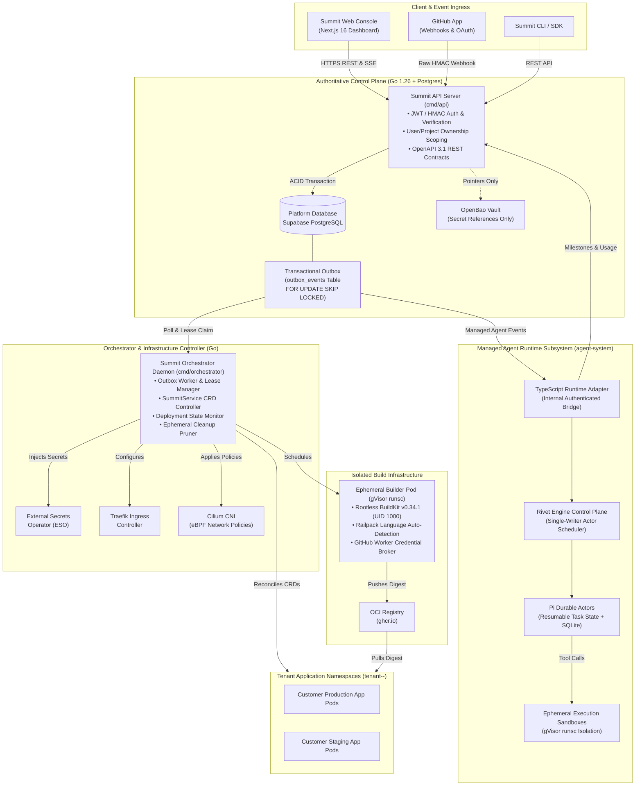
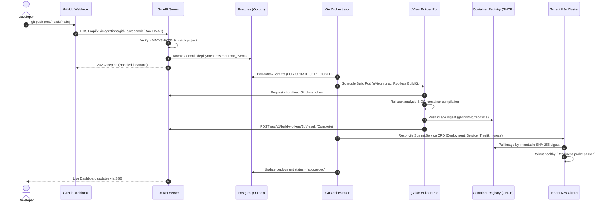

# Summit: High-Level System Architecture & Platform Topology

---

## 1. End-to-End System Architecture

Summit separates concerns across four distinct operational planes:
1. **The Client Plane:** Next.js 16 Console Dashboard, CLI tools, and GitHub App webhooks.
2. **The Control Plane (`apps/backend`):** Go 1.26 API service, Supabase PostgreSQL with Transactional Outbox, and OpenBao secrets vault.
3. **The Infrastructure Data Plane:** Kubernetes orchestrator daemon, Traefik ingress controller, Cilium CNI, and tenant application pods.
4. **The Managed Agent Execution Subsystem (`agent-system`):** TypeScript adapter, Rivet Actor control plane, Pi Durable runtime, and ephemeral gVisor sandboxes.



---

## 2. Structural Isolation Boundaries

Summit enforces three strict, non-negotiable architectural boundaries:

```
+---------------------------------------------------------------------------------------------------+
|                                  SUMMIT 3-TIER ISOLATION BOUNDARY                                 |
+--------------------------+------------------------------------------------------------------------+
| Boundary                 | Invariant & Implementation Mechanism                                   |
+--------------------------+------------------------------------------------------------------------+
| **1. Control Plane vs.** | The Go API and PostgreSQL maintain platform state only. Customer code  |
|    **Customer Code**     | and customer binaries **never execute** in the Go backend, API server, |
|                          | or platform database. Code runs strictly in unprivileged pods.        |
+--------------------------+------------------------------------------------------------------------+
| **2. Rivet Engine vs.**  | Rivet workers execute trusted runtime actors only. Pi Durable coding   |
|    **Agent Sandboxes**   | tools (bash, file writes, code execution) are **physically prevented**  |
|                          | from running in the Rivet worker. They dispatch to gVisor sandboxes.   |
+--------------------------+------------------------------------------------------------------------+
| **3. Zero Secrets in**   | The platform database **never stores secret values** in plaintext or   |
|    **Platform Database** | ciphertext. DB stores only OpenBao/KMS pointers. Secrets are resolved  |
|                          | dynamically by ESO into customer namespaces or by Credential Brokers.  |
+--------------------------+------------------------------------------------------------------------+
```

---

## 3. Core Operational Workflows

### Workflow A: Git Push to Deployment (The PaaS Pipeline)



---

### Workflow B: Managed Agent Prompt & Resumable Execution

```mermaid
sequenceDiagram
    autonumber
    actor Dev as Developer / User
    participant API as Go API Server
    participant Storage as Encrypted Object Store
    participant DB as Postgres (Outbox)
    participant Orch as Go Outbox Worker
    participant Adapter as TypeScript Adapter
    participant Actor as Rivet Actor (Pi Durable)
    participant Broker as Credential Broker
    participant Box as gVisor Sandbox Pod

    Dev->>API: POST /api/v1/agent-sessions/{id}/runs (Prompt: "Fix bug #42")
    API->>API: Authorize user/project & generate request_hash
    API->>Storage: Store encrypted prompt input payload
    API->>DB: Atomic commit: agent_runs (queued) + outbox_events
    API-->>Dev: 202 Accepted (durable run_id returned)

    Orch->>DB: Claim agent.run.submit.requested outbox event
    Orch->>Adapter: Deliver authenticated event payload
    Adapter->>API: Fetch encrypted prompt input over internal TLS
    Adapter->>Actor: Submit run to Rivet Actor ["summit-agent-v1", proj, dep, sess]
    Actor->>Actor: Pi Durable deserializes state & begins reasoning loop

    Actor->>Broker: Request scoped model credentials
    Broker-->>Actor: Return short-lived Model Gateway proxy token
    Actor->>Actor: LLM generates tool call: execute_bash("npm test")

    Actor->>Box: Forward command to isolated gVisor sandbox
    Box->>Box: Execute inside unprivileged virtualized kernel
    Box-->>Actor: Return command stdout/stderr
    Actor->>Actor: Pi records durable step in SQLite journal
    
    Actor->>Adapter: Emit runtime milestone event
    Adapter->>API: Internal callback: POST /events (monotonic sequence)
    API->>DB: Record agent_events projection & update metering
    API-->>Dev: SSE Stream delivers milestone update in real time
```

---

## 4. Kubernetes Namespace & Network Topology

```text
===================================================================================
                       SUMMIT KUBERNETES TOPOLOGY
===================================================================================

[ Namespace: summit-control-plane ]
  ├── api-server (Deployment, 3 replicas, Go 1.26)
  ├── orchestrator-daemon (Deployment, Active/Passive leader election)
  ├── openbao-vault (StatefulSet, HA Raft storage)
  └── external-secrets-operator (Controller)

[ Namespace: agent-system ]
  ├── ts-agent-adapter (Deployment, internal mTLS endpoint)
  ├── rivet-control-plane (Deployment, single-writer actor scheduler)
  ├── rivet-workers (StatefulSet / Deployment, Pi Durable actor execution)
  └── scoped-credential-broker (Deployment, OpenBao capability resolver)

[ Namespace: summit-builders ]  <-- Hardened by Cilium CNI (Default Deny)
  ├── buildkit-job-001 (gVisor runsc, rootless, ephemeral, auto-pruned)
  └── buildkit-job-002 (gVisor runsc, rootless, ephemeral, auto-pruned)

[ Namespace: agent-sandboxes ]  <-- Hardened by Cilium CNI (Strict Egress Allowlist)
  ├── sandbox-run-attempt-101 (gVisor runsc, ephemeral micro-VM)
  └── sandbox-run-attempt-102 (gVisor runsc, ephemeral micro-VM)

[ Namespace: tenant-<user_slug>-<project_slug> ]
  ├── summit-service-api (Deployment, customer application)
  ├── summit-service-frontend (Deployment, customer web client)
  └── traefik-ingress-routes (CRD, SSL/TLS terminated at edge)
===================================================================================
```
