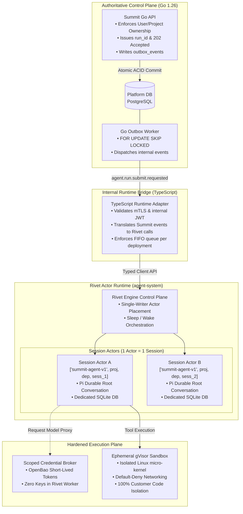
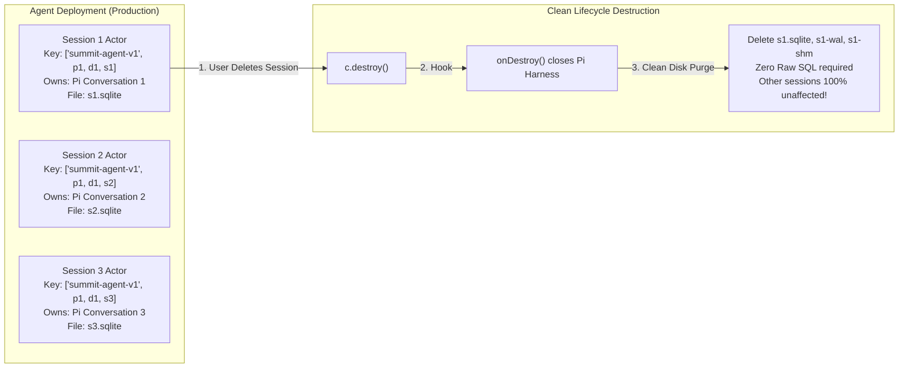
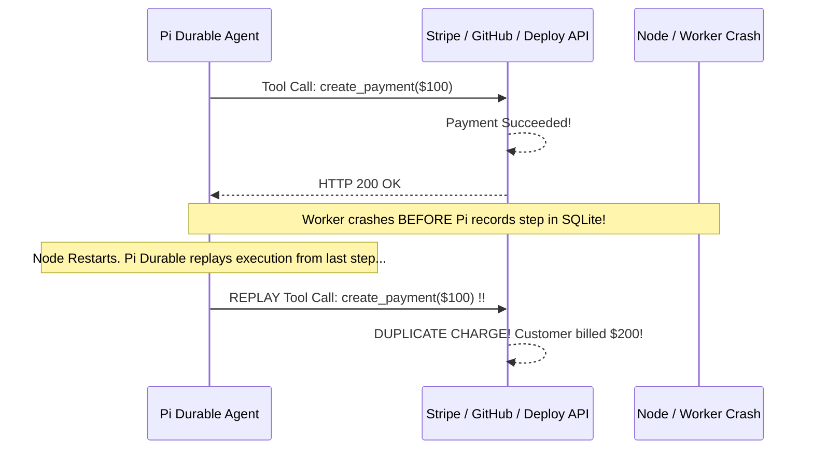

# Summit: Managed Agents Subsystem Deep-Dive (Rivet & Pi Durable)

---

## 1. Executive Summary & Vision

Managed Agents represent the frontier of the Summit Developer Platform. While traditional cloud providers treat AI as stateless, one-off REST API completions, Summit introduces **Autonomous Managed Agents as first-class, stateful platform workloads**.

Summit agents can independently:
- Clone and analyze customer repositories.
- Execute bash commands, run test suites, and inspect errors inside secure micro-VM sandboxes.
- Propose code modifications and submit pull requests.
- Sleep during prolonged external waits and wake up seamlessly upon receiving webhooks or developer responses.
- Recover immediately from process crashes, node failures, and network partitions without losing hours of conversational reasoning or execution history.

To achieve this, Summit integrates **Rivet Actors** (actor-model scheduling and lifecycle) with **Pi Durable** (resumable conversational harness) and **Google gVisor** (untrusted code execution).

---

## 2. The Core Architecture & Data Flow



---

## 3. The Big Architectural Breakthrough: ADR 0001 & The Session Pivot

During initial architectural design, the team considered mapping one Rivet Actor per agent deployment, housing all user sessions inside that single actor. However, a rigorous engineering audit of `@earendil-works/pi-durable@1.4.0` revealed a critical flaw:

### The Problem
- Pi Durable does not expose a public API to delete or purge individual conversations from its SQLite database.
- Housing multiple sessions in one actor meant that when a user deleted a conversation or requested GDPR right-to-be-forgotten, Summit would have to run raw `DELETE FROM conversations WHERE ...` SQL statements against Pi's internal SQLite database, corrupting internal foreign keys and breaking transaction invariants.

### The Architectural Solution: ADR 0001 Fallback
Summit adopted the **One Rivet Actor per Summit Session** model:

```text
Actor Key Tuple: ["summit-agent-v1", project_id, deployment_id, session_id]
```



**Key Benefits of this Design:**
1. **Total State Isolation:** Each conversation has its own dedicated SQLite database file. No context leaks across conversations.
2. **Graceful Destruction:** Calling `c.destroy()` invokes Rivet's `onDestroy` lifecycle callback, cleanly flushes and closes the Pi Harness, and then standard filesystem APIs delete the `.sqlite`, `.sqlite-wal`, and `.sqlite-shm` files.
3. **Zero Risk of Database Corruption:** No custom SQL hacking into Pi's internal schemas.

---

## 4. Gate 1 Proof of Concept (PoC) & Verification Results

Before writing production Kubernetes manifests, the team implemented and verified the complete runtime behavior inside `poc-managed-agents/`.

### Verified Environment & Components
- **Language & Runtime:** TypeScript / Node.js 22.19+ (pnpm 12.15.0).
- **Core Dependencies:** `@earendil-works/pi-durable@1.4.0`, `@earendil-works/pi-ai@1.4.0`, and `rivetkit@3.0.0-preview.2`.
- **Rivet Engine:** Statically linked musl/glibc Linux x64 binary (`@rivetkit/engine-cli-linux-x64-musl`) running natively in local test suites.

### The 10 Verified Invariants (Passed 100%)

```text
========================================================================================
                      GATE 1 POC VERIFIED TEST SUITE INVARIANTS
========================================================================================
 [PASS] 1. Multi-Conversation Isolation: 
           Concurrent prompts in one harness maintain strictly isolated transcripts.
 [PASS] 2. FIFO Order Admittance: 
           Submissions within a conversation settle strictly in arrival order.
 [PASS] 3. Idempotent Deduplication: 
           Reusing a conversation request ID returns the cached submission instantly.
 [PASS] 4. Tamper / Conflict Detection: 
           Reusing a request ID with altered prompt or session produces a 409 Conflict.
 [PASS] 5. Crash Recovery: 
           Closing and reopening a harness over existing SQLite files recovers full state.
 [PASS] 6. Synthetic Namespace Scoping: 
           Storage paths correctly segment by [project_id, deployment_id, session_id].
 [PASS] 7. Deterministic Request Hashing: 
           Canonical SHA-256 tuples guarantee idempotency regardless of JSON key order.
 [PASS] 8. Multi-Actor Concurrent Execution: 
           Separate session actors execute in parallel with zero lock contention.
 [PASS] 9. Actor Destruction & Storage Purge: 
           c.destroy() triggers onDestroy hook, shuts down Pi, and deletes SQLite/WAL files.
 [PASS] 10. Post-Destruction Enforcement: 
           Queries to destroyed actors return authoritative actor: not_found errors.
========================================================================================
```

*(Note: Multi-agent independent code review using **Gemini 3.8 Flash** confirmed zero defects across the PoC codebase!)*

---

## 5. Durable Execution vs. Exactly-Once Tool Safety

A critical architectural insight of Summit: **Durable execution is NOT exactly-once execution**.

### The Danger: The Crash-Replay Vulnerability



### Summit's 4-Tier Idempotency Solution

Summit eliminates duplicate side effects by establishing explicit idempotency boundaries at every layer:

```
+---------------------------------------------------------------------------------------------------+
|                                  SUMMIT 4-TIER IDEMPOTENCY MODEL                                  |
+--------------------------+-----------------------+------------------------------------------------+
| Layer                    | Key / Identifier      | Responsibility & Protection                    |
+--------------------------+-----------------------+------------------------------------------------+
| **1. Public REST API**   | `idempotency_key` +   | Prevents client network retries from creating  |
|                          | `request_hash`        | duplicate runs or double-charging quota.      |
+--------------------------+-----------------------+------------------------------------------------+
| **2. Pi Durable Engine** | `requestId`           | Native Pi deduplication; returns cached        |
|                          | (= Summit `run_id`)   | conversational response on re-submission.      |
+--------------------------+-----------------------+------------------------------------------------+
| **3. Side-Effect Tools** | `operation_id`        | Derived: SHA256(run_id + tool_call_id).        |
|                          |                       | Receiving service deduplicates external calls. |
+--------------------------+-----------------------+------------------------------------------------+
| **4. Event Telemetry**   | `source_event_id` +   | Monotonic sequences guarantee UI and billing   |
|                          | monotonic `sequence`  | ledgers never count duplicate usage facts.     |
+--------------------------+-----------------------+------------------------------------------------+
```

---

## 6. Zero-Trust Scoped Credential Broker

```mermaid
flowchart TD
    subgraph RivetWorker["Rivet Worker Process (Shared Infrastructure)"]
        Actor["Pi Durable Actor\n(Contains NO API keys or DB passwords)"]
    end

    subgraph SummitBroker["Summit Scoped Credential Broker"]
        Broker["Credential Broker Service\n• Validates Session Identity\n• Checks Tool Permissions\n• Enforces Rate Limits & Expiry"]
        ModelProxy["Model Gateway Proxy\n• Forwards prompts to OpenAI/Anthropic/Gemini\n• Strips and returns raw model text only"]
    end

    subgraph SecretVault["OpenBao Vault (KMS Protected)"]
        Vault["Encrypted Secrets Engine\n• Model Provider Master Keys\n• Customer Project Secrets"]
    end

    Actor -->|"1. Request Model Inference"| ModelProxy
    ModelProxy -->|"2. Authenticate"| Broker
    Broker -->|"3. Fetch Master Key"| Vault
    ModelProxy -->|"4. Call Model Provider"| LLM["External LLM Provider\n(Anthropic / OpenAI / Google)"]
    LLM -->>|"5. Stream Response"| ModelProxy
    ModelProxy -->>|"6. Stream Token Deltas (Zero Keys Revealed)"| Actor
```

**Security Guarantees:**
- **Zero Secrets in Memory:** Rivet workers never hold OpenAI, Anthropic, or database credentials in process memory or environment variables.
- **Model Gateway Protection:** Model traffic passes through Summit's Model Gateway, preventing compromised actor prompts from exfiltrating underlying API tokens.
- **Ephemeral Sandbox Delivery:** Tool credentials (e.g., temporary Git clone tokens) are delivered directly to the isolated gVisor sandbox with a 15-minute time-to-live.
