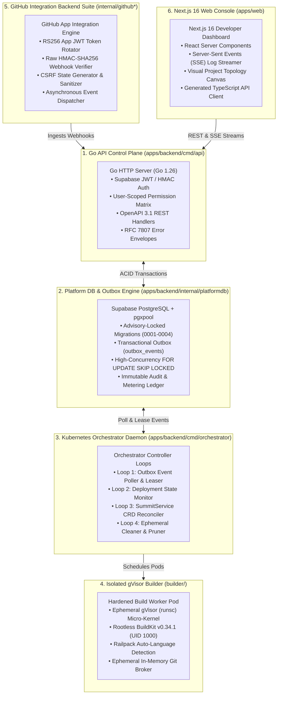
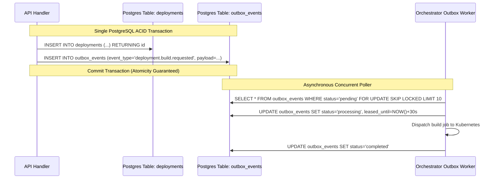

# Summit: Core Platform Components Breakdown

---

## 1. Architectural Component Map

Summit is designed as a unified monorepo (`Turborepo 2.11+`) integrating a high-performance Go control plane, an automated Kubernetes orchestrator, an isolated gVisor build engine, a TypeScript agent runtime, and a Next.js 16 console.



---

## 2. In-Depth Component Specifications

### Component 1: Go Control Plane API (`apps/backend/cmd/api`)

The Summit API server acts as the authoritative entry gate for all platform interactions.

- **Technology Stack:** Go 1.26.0, standard library `net/http` multiplexer with zero heavyweight framework overhead, resulting in sub-5ms response latencies and tiny memory footprints (<30MB idle).
- **Authentication & User Identity:**
  - Validates Supabase Auth JWTs using either asymmetric JWKS endpoint caching or HMAC-SHA256 secret verification.
  - Reconciles Supabase users directly into the local `users` table via `EnsureUser` on initial login.
- **Authorization & Ownership Model:**
  - Enforces strict **personal-user ownership**: every project belongs directly to an authenticated user (`projects.user_id = auth.uid`).
  - Child resources (services, deployments, agent definitions, runs) strictly inherit ownership via composite foreign keys.
- **Contract Enforcement:**
  - Complies strictly with OpenAPI 3.1 (`packages/api_spec/openapi.yaml`).
  - Emits RFC 7807 Problem Details error envelopes for consistent client error handling (`httpx.WriteError`).

---

### Component 2: Platform Database & Transactional Outbox (`apps/backend/internal/platformdb`)

Engineered for zero-loss asynchronous event dispatch, high-concurrency worker claims, and enterprise auditability.



- **Connection Management:** High-performance connection pooling via `jackc/pgx/v5/pgxpool` with automatic health checks and query timeouts.
- **Advisory-Locked Migrations:** Zero-downtime database evolution governed by PostgreSQL advisory locks (`pg_advisory_lock`), preventing race conditions when multiple API instances boot concurrently.
- **Outbox Engine:**
  - Eliminates the dual-write problem between database records and message queues.
  - Uses `FOR UPDATE SKIP LOCKED` for lock-free parallel event consumption across multiple orchestrator replicas.
  - Automatic exponential backoff with a maximum retry ceiling.

---

### Component 3: Kubernetes Orchestrator Daemon (`apps/backend/cmd/orchestrator`)

The Kubernetes Orchestrator daemon acts as the continuous bridge between declarative intent in the platform database and physical cloud infrastructure.

The daemon runs 4 concurrent, fault-tolerant background reconciliation loops:

| Reconciliation Loop | Execution Interval | Responsibility |
| :--- | :--- | :--- |
| **1. Outbox Worker Loop** | 100ms – 1s (adaptive) | Continuously polls `outbox_events` via `FOR UPDATE SKIP LOCKED`, acquires leases, and dispatches build or agent jobs. |
| **2. Deployment Monitor Loop** | 5 seconds | Queries active Kubernetes pods, checks container readiness/liveness probes, and transitions deployment statuses in the DB. |
| **3. SummitService Reconciler** | Event-driven (CRD watch) | Reconciles `SummitService` Custom Resource Definitions into K8s Deployments, ClusterIP Services, Traefik IngressRoutes, and Cilium NetworkPolicies. |
| **4. Cleaner & Pruner Loop** | 60 seconds | Detects finished, failed, or orphaned build pods and ephemeral sandbox volumes, freeing node compute and memory resources. |

---

### Component 4: Isolated Ephemeral Builder (`builder/`)

Summit builds untrusted customer code directly from Git repositories without running bloated virtual machines or risking host-kernel compromises.

```text
========================================================================================
                       ISOLATED BUILDER POD ARCHITECTURE
========================================================================================
[ Kubernetes Pod: summit-builder-job-xyz ]
  │
  ├── Security RuntimeClass: gvisor (runsc)  <-- Hardware-isolated user-space kernel
  ├── Container SecurityContext:
  │     ├── runAsUser: 1000 (Non-root 'builder' user)
  │     ├── runAsGroup: 1000
  │     ├── readOnlyRootFilesystem: true
  │     ├── allowPrivilegeEscalation: false
  │     └── capabilities: DROP ALL
  │
  ├── Subsystem 1: Rootless BuildKit v0.34.1
  │     └── Executes container assembly in user namespaces without host root access.
  │
  ├── Subsystem 2: Railpack Engine v0.43.0
  │     └── Automatically detects language stacks (Node, Python, Go, Rust, Ruby)
  │         and generates optimized multi-stage OCI build instructions.
  │
  └── Subsystem 3: Ephemeral Credential Broker
        └── In-memory Git clone token handler; wiped immediately upon build completion.
========================================================================================
```

- **Sub-Second Spin-Up:** Unlike AWS CodeBuild or Firecracker VMs that require 30–60s to boot, gVisor builder pods initialize in <800ms.
- **Direct Registry Push:** Compiles images directly to GHCR (`ghcr.io`) using immutable content-addressable SHA-256 digests.

---

### Component 5: GitHub Integration Backend Suite

Provides complete Git automation from repository linking to automated webhook deployments:

- **Asymmetric App Authentication:** Uses GitHub App credentials with RS256 private keys to mint short-lived (10-minute) installation tokens.
- **Raw HMAC Webhook Security:** Intercepts incoming GitHub webhooks at the raw byte level, computing `HMAC-SHA256` signatures before JSON unmarshalling to defend against payload tampering and denial-of-service.
- **Anti-CSRF Installation State:** Generates cryptographically secure, single-use state tokens (`installstate`) during GitHub App installation to prevent OAuth redirect hijacking.
- **Sanitized Workspace Navigation:** Enforces strict path sanitization (`sourcepath`) preventing directory traversal attacks (e.g. `../../etc/passwd`) within mono-repositories.

---

### Component 6: Next.js 16 Console Dashboard (`apps/web`)

Delivers a responsive, intuitive interface for developers and operators:

- **Framework:** Next.js 16 with React 19 Server Components and App Router.
- **Real-Time Log Viewer:** Connects to the Go backend's Server-Sent Events (SSE) streaming endpoint, rendering colorized build logs and agent step outputs with zero client lag.
- **Interactive Topology Editor:** Visual canvas enabling developers to connect microservices, databases, and managed agents into live architecture diagrams.
- **Type-Safe SDK:** UI fetches directly consume TypeScript models compiled from the authoritative OpenAPI 3.1 specification (`@summit/api-spec`).
