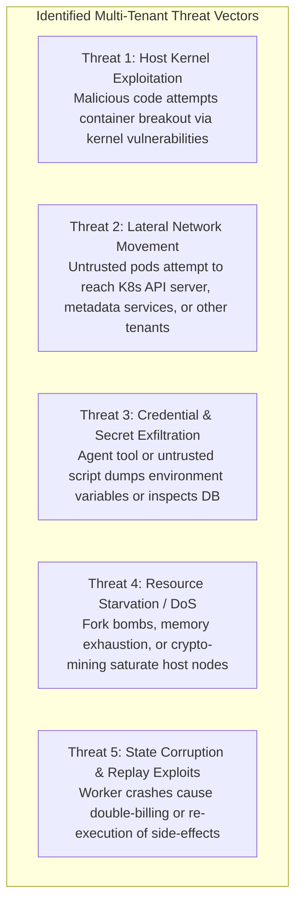
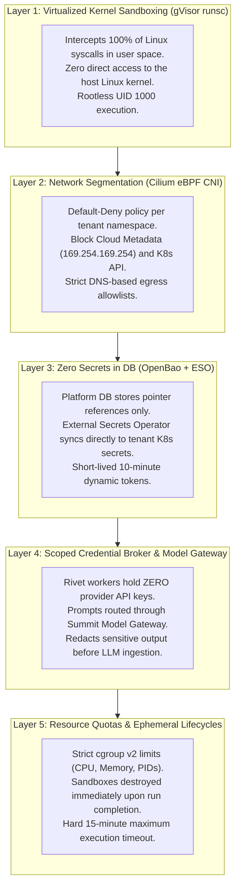
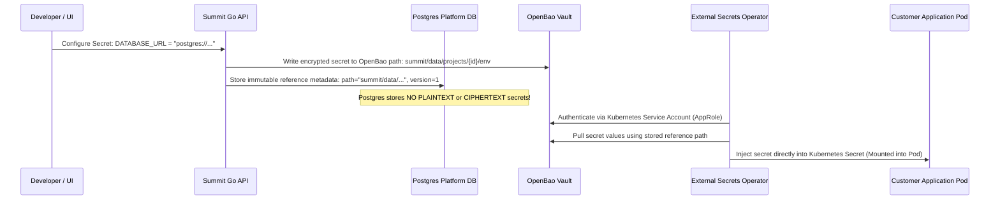

# Summit: Security Architecture, Isolation & Reliability Engineering

---

## 1. The Multi-Tenant Threat Model

Hosting arbitrary customer code alongside autonomous AI agents creates a complex attack surface. Summit is engineered with a **Zero-Trust, Defense-in-Depth Security Model** designed to mitigate 5 primary threat vectors:



---

## 2. The 5-Layer Defense-in-Depth Architecture



---

## 3. Sandboxing Deep-Dive: Why Google gVisor (`runsc`)?

Traditional container platforms rely on shared Linux namespaces and cgroups (standard Docker / containerd `runc`). In standard containers, any zero-day vulnerability in the host Linux kernel gives an attacker full control over every tenant on the physical server.

Full hardware virtual machines (AWS EC2 / Firecracker) provide strong isolation, but suffer from slow boot times (10–45s) and excessive memory overhead (>128MB per instance).

### Comparative Sandboxing Matrix

| Dimension | Standard Docker (`runc`) | Micro-VMs (Firecracker) | **Summit Sandboxes (`gVisor runsc`)** |
| :--- | :--- | :--- | :--- |
| **Isolation Strength** | Low (Shared host kernel) | High (Hardware virtualization) | **High (Independent user-space kernel `Sentry`)** |
| **Startup Latency** | ~200ms | 5,000ms – 15,000ms | **~400ms (Near-instant)** |
| **Memory Overhead** | ~15MB | 128MB – 256MB | **~25MB** |
| **Host Kernel Attack Surface**| ~400+ Linux Syscalls exposed | Minimal (KVM device) | **Zero host syscalls (Handled by Sentry in Go)** |
| **Kubernetes Compatibility** | Native | Complex (Needs custom daemons) | **Native (`RuntimeClass: gvisor`)** |

In Summit, all builder jobs (`builder/`) and agent code-execution sandboxes (`poc-managed-agents/src/sandbox.ts`) run exclusively under the `gvisor` RuntimeClass.

---

## 4. Secrets Management: Zero Secrets in Platform DB

A foundational principle of Summit is: **Never store secret values in the platform database.**



- **OpenBao Vault:** Provides hardware-backed KMS encryption at rest, automatic secret rotation, and audit logs.
- **External Secrets Operator (ESO):** Bridges OpenBao directly to Kubernetes namespace secrets without passing values through the Go API control plane.
- **Agent Sandbox Credential Broker:** Agent tools receive single-purpose, ephemeral credentials (such as temporary Git clone tokens) with a 15-minute TTL, destroyed upon run completion.

---

## 5. Network Security & Cilium eBPF Policies

Every customer deployment and agent sandbox is protected by strict Cilium network policies operating at the eBPF kernel layer:

```yaml
apiVersion: "cilium.io/v2"
kind: CiliumNetworkPolicy
metadata:
  name: "tenant-default-deny-and-protect"
  namespace: "tenant-acme-prod"
spec:
  endpointSelector:
    matchLabels: {}
  ingress:
    # Allow incoming traffic ONLY from Traefik Ingress Gateway
    - fromEndpoints:
        - matchLabels:
            app.kubernetes.io/name: "traefik"
      toPorts:
        - ports:
            - port: "8080"
              protocol: TCP
  egress:
    # Deny all internal Kubernetes API and Cloud Metadata access
    - toCIDR:
        - "0.0.0.0/0"
      exceptCIDRs:
        - "169.254.169.254/32" # Block AWS/GCP Instance Metadata Service
        - "10.96.0.1/32"       # Block Kubernetes Core API Server
    # Allow DNS resolution only via CoreDNS
    - toEndpoints:
        - matchLabels:
            k8s-app: "kube-dns"
      toPorts:
        - ports:
            - port: "53"
              protocol: UDP
```

---

## 6. Distributed Reliability & Crash Recovery

Summit achieves high availability and fault tolerance through four interlocking architectural mechanisms:

```
+---------------------------------------------------------------------------------------------------+
|                                  SUMMIT RELIABILITY ARCHITECTURE                                  |
+--------------------------+------------------------------------------------------------------------+
| Mechanism                | Invariant & Failure Protection                                         |
+--------------------------+------------------------------------------------------------------------+
| **1. Transactional**     | Platform mutations and outbox event emissions occur inside a single    |
|    **Outbox Engine**     | ACID transaction. Network failures can never drop an event.            |
+--------------------------+------------------------------------------------------------------------+
| **2. Advisory-Locked**   | Node reboots or concurrent horizontal scaling instances cannot cause   |
|    **Workers**           | double-processing. Workers claim batches with `FOR UPDATE SKIP LOCKED`.|
+--------------------------+------------------------------------------------------------------------+
| **3. Pi Durable SQLite** | Agent conversational state is persisted to disk using SQLite Write-    |
|    **WAL Journaling**    | Ahead Logging (WAL). Reopening the database file instantly recovers    |
|                          | full execution context after ungraceful worker termination.           |
+--------------------------+------------------------------------------------------------------------+
| **4. Rivet Actor**       | Rivet ensures at most one worker process writes to an actor ID at any  |
|    **Single-Writer**     | time, preventing split-brain state corruption in multi-worker pools.   |
+--------------------------+------------------------------------------------------------------------+
```
